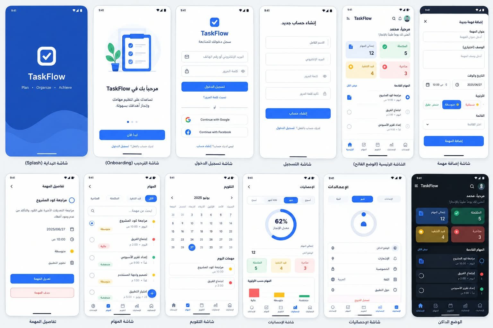

# TaskFlow Flutter

A task management application built with Flutter and GetX.
<!-- <p align="center">
  
  &nbsp;&nbsp;&nbsp;&nbsp;
  
</p> -->
## About the Project

TaskFlow is a Flutter application designed to help users organize and manage their daily tasks.

## Built With

- Flutter
- Dart
- GetX

## Getting Started

To run this project locally:

1. Clone the repository.
2. Open the project folder in VS Code.
3. Install the dependencies:

   ```bash
   flutter pub get
   ```

4. Run the application:

   ```bash
   flutter run
   ```

## Project Status

Currently under development.

